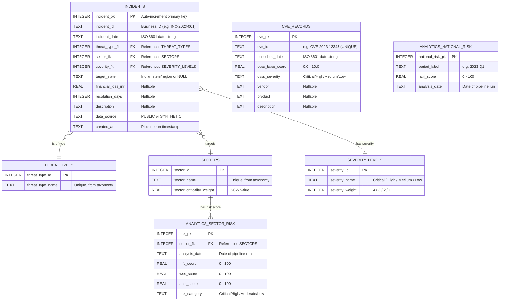
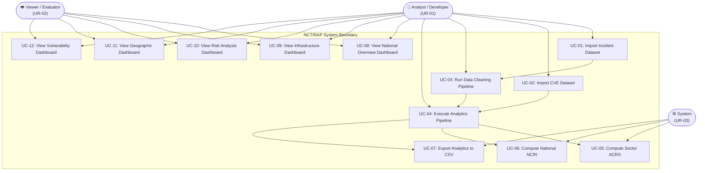
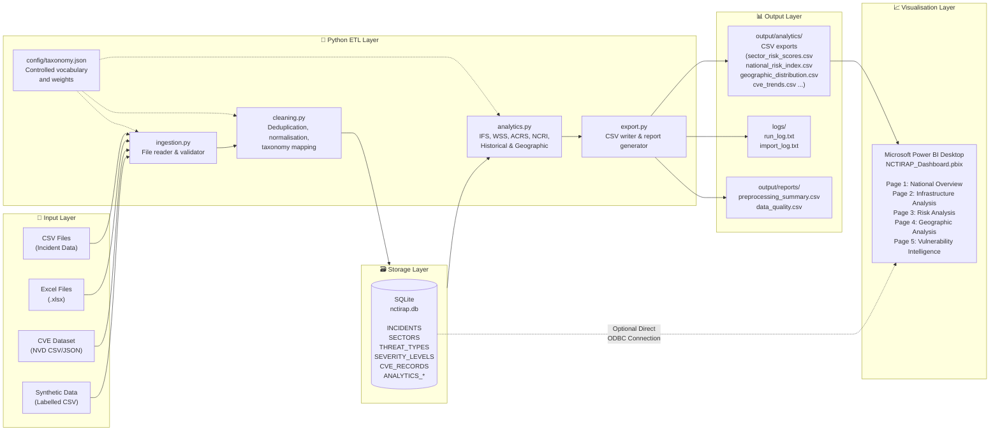
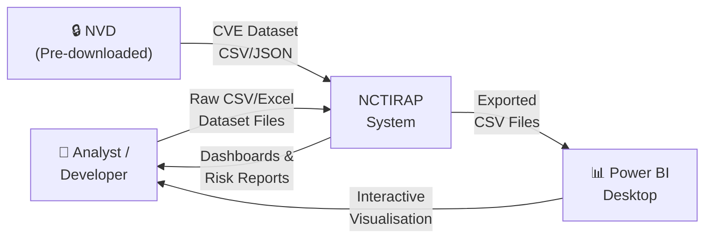
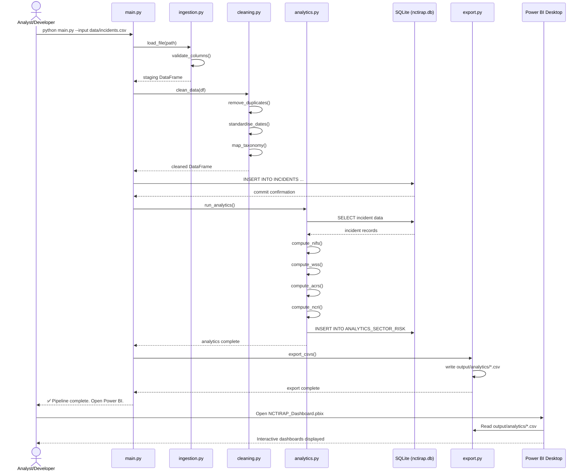

# Software Requirements Specification (SRS)

## National Cyber Threat Intelligence & Risk Analytics Platform

---

| Document Attribute | Details |
|---|---|
| **Document Title** | Software Requirements Specification — National Cyber Threat Intelligence & Risk Analytics Platform |
| **Version** | 1.0 |
| **Status** | Draft — Awaiting Author Approval |
| **Prepared By** | B.Tech Computer Science Student |
| **Domain** | Cybersecurity · Data Analytics · Data Visualization · National Security |
| **Date** | October 2026 |
| **Classification** | Academic / Non-Confidential |

---

> **⚠️ Academic Disclaimer**
>
> This document describes an academic prototype developed as a college Software Engineering project. The system does **not** perform real-time monitoring, does **not** connect to government or classified networks, and does **not** claim to represent any official national cybersecurity standard or government policy. All risk models, scores, and analytical outputs are defined solely for educational demonstration purposes. Synthetic data used within the system is clearly labelled as such and does not represent real-world cyber incidents.

---

## Table of Contents

1. [Introduction](#1-introduction)
2. [Purpose and Project Scope](#2-purpose-and-project-scope)
3. [Overall System Description](#3-overall-system-description)
4. [User Roles](#4-user-roles)
5. [Functional Requirements](#5-functional-requirements)
6. [Non-Functional Requirements](#6-non-functional-requirements)
7. [External Interface Requirements](#7-external-interface-requirements)
8. [Data Requirements](#8-data-requirements)
9. [Database Design](#9-database-design)
10. [Use Cases](#10-use-cases)
11. [UML Diagrams](#11-uml-diagrams)
12. [System Architecture](#12-system-architecture)
13. [Requirements Traceability Matrix](#13-requirements-traceability-matrix)
14. [Acceptance Criteria and Testing Requirements](#14-acceptance-criteria-and-testing-requirements)
15. [Project Limitations](#15-project-limitations)
16. [Future Enhancements](#16-future-enhancements)
17. [References](#17-references)

---

## 1. Introduction

### 1.1 Document Purpose

This Software Requirements Specification (SRS) document formally describes the functional and non-functional requirements, system architecture, data model, and design constraints for the **National Cyber Threat Intelligence & Risk Analytics Platform** (hereinafter referred to as "the System" or "NCTIRAP"). It is intended to serve as the authoritative reference for all subsequent design, development, and testing activities undertaken as part of this academic project.

### 1.2 Intended Audience

| Audience | Purpose |
|---|---|
| Project Author (Developer) | Primary development reference |
| Faculty Supervisor / Guide | Project evaluation and review |
| External Examiners | Viva voce and project assessment |
| Peer Reviewers | Academic feedback and critique |

### 1.3 Document Conventions

- **Requirement IDs**: Each requirement is assigned a unique identifier following the pattern `[TYPE]-[NNN]`, where `[TYPE]` denotes the requirement category (e.g., `FR` for Functional, `NFR` for Non-Functional, `DR` for Data, `IR` for Interface) and `[NNN]` is a three-digit sequence number starting from `001`.
- **Priority Classification**: Requirements are classified using the MoSCoW method:
  - **Must Have (M)**: Essential; the system cannot be considered complete without this.
  - **Should Have (S)**: Important but not critical for initial delivery.
  - **Could Have (C)**: Desirable if time and resources permit.
- **Diagram Source**: All UML and architectural diagrams are provided as Mermaid source code for reproducibility.
- **Assumptions**: All assumptions made due to uncertainty in data availability or design are explicitly stated and numbered as `ASM-[NNN]`.

### 1.4 Definitions, Acronyms, and Abbreviations

| Term / Acronym | Definition |
|---|---|
| APT | Advanced Persistent Threat — a stealthy, long-term cyber attack by a well-resourced actor |
| CIA Triad | Confidentiality, Integrity, and Availability — the three core principles of information security |
| CERT-In | Indian Computer Emergency Response Team |
| CVE | Common Vulnerabilities and Exposures — a public database of disclosed software vulnerabilities |
| CVSS | Common Vulnerability Scoring System — a standardised scoring framework for vulnerability severity |
| DDoS | Distributed Denial of Service attack |
| ETL | Extract, Transform, Load — data pipeline operations |
| ICS | Industrial Control System |
| NCTIRAP | National Cyber Threat Intelligence & Risk Analytics Platform (this system) |
| NLP | Natural Language Processing |
| NVD | National Vulnerability Database — maintained by NIST (USA) |
| OSINT | Open Source Intelligence |
| Power BI | Microsoft Power BI — a business intelligence and data visualisation tool |
| SCADA | Supervisory Control and Data Acquisition |
| SRS | Software Requirements Specification |
| SQLite | A lightweight, file-based relational database engine |

### 1.5 Overview of the SRS

Section 2 defines the scope and objectives. Section 3 describes the overall system context. Section 4 identifies user roles. Sections 5 and 6 enumerate functional and non-functional requirements. Sections 7 through 9 cover interface, data, and database requirements. Section 10 presents use cases, and Section 11 provides UML diagrams. Section 12 details the system architecture. Sections 13 and 14 provide traceability and testing criteria. Sections 15 and 16 discuss limitations and future directions. Section 17 lists references.

---

## 2. Purpose and Project Scope

### 2.1 Problem Statement

India's critical infrastructure sectors — including power, telecommunications, banking, healthcare, transportation, and government services — face an increasing volume and sophistication of cyber threats. Despite the existence of public threat intelligence feeds, CVE databases, and incident reports, there is no consolidated academic tool that allows students and researchers to perform structured, exploratory analysis of these threats, calculate sector-level risk scores, and visualise the results interactively.

### 2.2 Project Objective

The primary objective of NCTIRAP is to build an academic, offline, data-driven analytics platform that:

1. Ingests structured cybersecurity datasets (public incident data and clearly labelled synthetic data).
2. Cleans, normalises, and stores data in a relational database.
3. Performs analytical computations including trend analysis, sector-level risk scoring, and vulnerability assessment.
4. Exports processed results to Microsoft Power BI for interactive visualisation.
5. Presents findings across themed dashboard pages covering national overview, critical infrastructure, risk analysis, geographic distribution, and vulnerability intelligence.

### 2.3 Project Scope

#### 2.3.1 In Scope

- Import of cybersecurity incident data from CSV/Excel files.
- Import of CVE/vulnerability data from publicly available datasets (e.g., NVD data feeds in CSV or JSON format).
- Data cleaning, normalisation, and transformation using Python (Pandas, NumPy).
- Storage in a local SQLite database.
- Computation of a project-defined Academic Cyber Risk Score (ACRS).
- Export of analytical results to CSV files for consumption by Power BI.
- Five themed Power BI dashboard pages (with the first three prioritised for initial delivery).
- Geographic analysis where reliable, non-sensitive location data exists in public datasets.
- Documentation of all assumptions, limitations, and data provenance.

#### 2.3.2 Out of Scope

- Real-time monitoring, alerting, or live data ingestion.
- Connection to any government network, classified database, or restricted API.
- Machine learning or AI-based threat prediction models.
- Deployment as a public-facing web application (a future enhancement only).
- Processing of personally identifiable information (PII).
- Any claim of compliance with official government risk frameworks (e.g., NCIIPC guidelines, CERT-In mandates).

### 2.4 Project Deliverables

| Deliverable | Description |
|---|---|
| SRS Document | This document |
| Python ETL Scripts | Data ingestion, cleaning, and processing scripts |
| SQLite Database | `nctirap.db` — structured storage of processed data |
| Power BI Report | `NCTIRAP_Dashboard.pbix` — interactive visualisation |
| Sample/Synthetic Dataset | Clearly labelled CSV files with synthetic cyber incident records |
| Project Report | Final academic report documenting findings |

---

## 3. Overall System Description

### 3.1 System Context

NCTIRAP operates as a standalone, offline academic analytics tool running on a local workstation. It does not require an internet connection during normal operation. Data is sourced from pre-downloaded public datasets and synthetic CSV files. The system follows a classical **ETL → Storage → Analytics → Visualisation** pipeline.

### 3.2 System Overview

The system is composed of four logical layers:

| Layer | Technology | Responsibility |
|---|---|---|
| **Data Ingestion Layer** | Python, Pandas | Reading and validating raw CSV/Excel input files |
| **Processing & Storage Layer** | Python, NumPy, SQLite | Cleaning, transforming, scoring, and persisting data |
| **Analytics Layer** | Python, Pandas, NumPy | Computing statistics, trends, risk scores, and aggregations |
| **Visualisation Layer** | Microsoft Power BI | Interactive dashboards consuming exported CSV/SQLite data |

### 3.3 Operating Environment

| Attribute | Specification |
|---|---|
| Operating System | Windows 10/11 (primary); compatible with macOS and Linux for Python scripts |
| Python Version | Python 3.10 or later |
| Key Python Libraries | Pandas ≥ 2.0, NumPy ≥ 1.24, sqlite3 (standard library) |
| Database | SQLite 3 (via Python's built-in `sqlite3` module) |
| Visualisation Tool | Microsoft Power BI Desktop (free version, latest release) |
| Development Environment | VS Code or any Python-compatible IDE |
| Hardware (Minimum) | 4 GB RAM, dual-core CPU, 5 GB free disk space |

### 3.4 Assumptions

| ID | Assumption |
|---|---|
| ASM-001 | The developer has access to publicly available cybersecurity incident datasets or will create clearly labelled synthetic datasets that approximate real-world distributions without claiming factual accuracy. |
| ASM-002 | The NVD CVE dataset (available at nvd.nist.gov as downloadable JSON/CSV feeds) will be used as the primary vulnerability data source. No API key or internet connection is required if the dataset is pre-downloaded. |
| ASM-003 | Geographic location data in incident records refers to broad Indian state or region names available in public reports (e.g., CERT-In annual reports), not precise coordinates or classified location data. |
| ASM-004 | Microsoft Power BI Desktop is available on the developer's machine at no cost. |
| ASM-005 | The system will be used by a single user (the developer/demonstrator) on a local machine. Multi-user access or concurrent use is not required. |
| ASM-006 | "Critical infrastructure sectors" for this project are defined according to the categories described in publicly available CERT-In and NCIIPC reports (e.g., Power, Telecom, Banking & Finance, Government, Healthcare, Transportation, Defence — excluding classified systems). |
| ASM-007 | All synthetic data records will include a mandatory field `data_source = "SYNTHETIC"` to prevent any confusion with real incident data. |

### 3.5 Constraints

- The system is an academic prototype and must not make security-critical decisions.
- No data may be transmitted over any network during processing.
- All risk scores are labelled as "Academic Model" and carry appropriate disclaimers in all visualisations.
- The initial implementation must be completable by a single beginner developer within one academic semester.

### 3.6 Dependencies

| Dependency | Type | Impact if Unavailable |
|---|---|---|
| Python 3.10+ | Runtime Environment | System cannot execute |
| Pandas, NumPy | Python Libraries | Data processing fails |
| SQLite (stdlib) | Database Engine | Data storage unavailable |
| Microsoft Power BI Desktop | Visualisation Tool | Dashboards cannot be rendered |
| Public CVE Dataset (pre-downloaded) | Data Source | Vulnerability module unavailable |
| Public Incident Dataset or Synthetic CSV | Data Source | All analytics unavailable |

---

## 4. User Roles

Since this is an academic prototype operated by a single developer/demonstrator, formal role-based access control is not implemented in the initial version. However, three conceptual user roles are defined for requirements clarity and future extensibility.

### 4.1 Role Definitions

| Role ID | Role Name | Description | Permissions |
|---|---|---|---|
| UR-01 | **Analyst / Developer** | The primary user who runs Python scripts, manages data, and operates the Power BI dashboard. | Full access to all system functions: data import, processing, database management, analytics, and dashboards. |
| UR-02 | **Viewer / Evaluator** | A faculty supervisor, examiner, or peer who reviews the dashboard output and project findings. | Read-only access to Power BI dashboards and exported reports. |
| UR-03 | **System (Automated Process)** | The Python scripting environment executing ETL and analytics pipelines. | Internal access to file system, SQLite database, and export directories. |

> **Note**: In the initial implementation, all user interactions are performed by the Analyst/Developer (UR-01). Role UR-02 access is achieved by sharing the Power BI `.pbix` file.

---

## 5. Functional Requirements

Requirements are grouped by the module they belong to. Each requirement has a unique ID, a description, its priority (MoSCoW), and the primary user role it serves.

---

### Module 1: Data Collection and Dataset Import

| Req. ID | Requirement Description | Priority | User Role |
|---|---|---|---|
| FR-001 | The system shall accept cybersecurity incident data as input in CSV and Excel (`.xlsx`) file formats. | Must Have | UR-01 |
| FR-002 | The system shall accept CVE/vulnerability data as input in CSV or JSON format (pre-downloaded from NVD). | Must Have | UR-01 |
| FR-003 | The system shall validate that all required columns are present in the input file before proceeding with ingestion. If mandatory columns are missing, the system shall report the missing fields and halt ingestion for that file. | Must Have | UR-01 |
| FR-004 | The system shall support batch import of multiple CSV files from a designated input directory. | Should Have | UR-01 |
| FR-005 | The system shall log the name, row count, and ingestion timestamp of every successfully imported file to a log file (`logs/import_log.txt`). | Should Have | UR-01 |
| FR-006 | The system shall clearly tag all records originating from synthetic datasets with the field value `data_source = "SYNTHETIC"` throughout all downstream processing. | Must Have | UR-01 |

---

### Module 2: Data Cleaning and Preprocessing

| Req. ID | Requirement Description | Priority | User Role |
|---|---|---|---|
| FR-007 | The system shall identify and report duplicate records based on a defined composite key (e.g., incident date + incident type + target sector). | Must Have | UR-01 |
| FR-008 | The system shall remove or flag duplicate records as configured by the developer. | Must Have | UR-01 |
| FR-009 | The system shall standardise date fields to the ISO 8601 format (`YYYY-MM-DD`). Records with unparseable date values shall be flagged and excluded from analytics with a warning. | Must Have | UR-01 |
| FR-010 | The system shall normalise categorical text fields (e.g., threat type, sector name) to a controlled vocabulary defined in a configuration file (`config/taxonomy.json`). Unrecognised values shall be mapped to the category "Other" with a warning logged. | Must Have | UR-01 |
| FR-011 | The system shall handle missing values in non-mandatory fields by imputing a designated null sentinel value (e.g., `"Unknown"` for strings, `-1` for numeric fields that lack a natural zero), preserving the record for analysis. | Should Have | UR-01 |
| FR-012 | The system shall generate a preprocessing summary report (CSV file) listing: total records ingested, duplicate count, records excluded, records with missing mandatory fields, and records successfully loaded into the database. | Should Have | UR-01 |
| FR-013 | The system shall normalise numeric fields (e.g., financial loss, duration) to consistent units as defined in the data dictionary. | Should Have | UR-01 |

---

### Module 3: Historical Cyber Threat Analytics

| Req. ID | Requirement Description | Priority | User Role |
|---|---|---|---|
| FR-014 | The system shall compute the monthly and annual frequency of cyber incidents, grouped by year, month, threat type, and target sector. | Must Have | UR-01 |
| FR-015 | The system shall calculate the percentage distribution of threat types (e.g., Ransomware, Phishing, DDoS, Data Breach, Malware) across the total incident dataset. | Must Have | UR-01 |
| FR-016 | The system shall identify the top five most frequently occurring threat types across all records and export the result to a CSV file. | Must Have | UR-01 |
| FR-017 | The system shall compute year-over-year (YoY) change in incident count per threat type, expressed as a percentage. | Should Have | UR-01 |
| FR-018 | The system shall identify the most targeted critical infrastructure sector for each calendar year present in the dataset. | Should Have | UR-01 |
| FR-019 | The system shall calculate the average estimated financial loss per incident for each threat type, where financial loss data is available. | Could Have | UR-01 |
| FR-020 | The system shall export all historical analytics outputs to a structured CSV directory (`output/analytics/`) for consumption by Power BI. | Must Have | UR-01 |

---

### Module 4: Critical Infrastructure Risk Analysis

| Req. ID | Requirement Description | Priority | User Role |
|---|---|---|---|
| FR-021 | The system shall define a static list of critical infrastructure sectors for India as specified in the taxonomy configuration file. The initial sectors shall include: Power & Energy, Telecommunications, Banking & Finance, Government Services, Healthcare, Transportation, and Defence (public/open data only). | Must Have | UR-01 |
| FR-022 | The system shall calculate a sector-level Incident Frequency Score (IFS) for each defined critical infrastructure sector. | Must Have | UR-01 |
| FR-023 | The system shall calculate a sector-level Severity Score (SS) based on the distribution of incident severity ratings (Critical, High, Medium, Low) within each sector. | Must Have | UR-01 |
| FR-024 | The system shall calculate a Sector Criticality Weight (SCW) based on a static, project-defined weighting table that ranks sectors by their importance to national functioning (see Section 8.3). | Must Have | UR-01 |
| FR-025 | The system shall compute the composite Academic Cyber Risk Score (ACRS) per sector using the formula defined in Section 8.4. All scores shall be normalised to the range [0, 100]. | Must Have | UR-01 |
| FR-026 | The system shall classify each sector's ACRS into one of four risk categories: Critical Risk (75–100), High Risk (50–74), Moderate Risk (25–49), or Low Risk (0–24). | Must Have | UR-01 |
| FR-027 | The system shall produce a ranked list of critical infrastructure sectors ordered by ACRS (descending) and export it to `output/analytics/sector_risk_scores.csv`. | Must Have | UR-01 |
| FR-028 | The system shall enable comparison of ACRS values across multiple sectors in the Power BI dashboard. | Should Have | UR-01, UR-02 |

---

### Module 5: National Cyber Risk Scoring

| Req. ID | Requirement Description | Priority | User Role |
|---|---|---|---|
| FR-029 | The system shall compute an aggregate National Cyber Risk Index (NCRI) by computing a weighted average of all sector ACRS values, with weights proportional to Sector Criticality Weights. | Must Have | UR-01 |
| FR-030 | The system shall display the NCRI prominently on the National Cyber Overview dashboard page with an explicit label stating: "Academic Model — Not an Official Government Metric." | Must Have | UR-01, UR-02 |
| FR-031 | The system shall compute and display a trend of NCRI over time (quarterly or annual) if sufficient temporal data exists. | Should Have | UR-01 |
| FR-032 | The system shall export the NCRI time series to `output/analytics/national_risk_index.csv`. | Should Have | UR-01 |

---

### Module 6: Geographic Analysis

| Req. ID | Requirement Description | Priority | User Role |
|---|---|---|---|
| FR-033 | The system shall, where reliable non-sensitive location data exists in the input dataset, extract and standardise Indian state/region names using the taxonomy configuration. | Should Have | UR-01 |
| FR-034 | The system shall compute the incident count per Indian state/region and export the result to `output/analytics/geographic_distribution.csv`. | Should Have | UR-01 |
| FR-035 | The system shall present geographic distribution data in a Power BI map visual or a filled bar chart if map data is unavailable. | Could Have | UR-01, UR-02 |
| FR-036 | The system shall clearly label any geographic data as "Approximate — Based on Publicly Reported Location" and shall not infer location data where it is absent. | Must Have | UR-01 |

---

### Module 7: Vulnerability Intelligence (CVE Data)

| Req. ID | Requirement Description | Priority | User Role |
|---|---|---|---|
| FR-037 | The system shall import a pre-downloaded NVD CVE dataset (CSV/JSON) and load relevant fields (CVE ID, description, CVSS base score, severity, affected product/vendor, publication date) into the database. | Should Have | UR-01 |
| FR-038 | The system shall filter CVE records to retain only those with a CVSS base score ≥ 7.0 (High or Critical severity) for focused analysis. | Should Have | UR-01 |
| FR-039 | The system shall categorise CVEs by affected product type or sector relevance (e.g., ICS/SCADA, Network Infrastructure, Web Applications) using keyword mapping defined in the taxonomy configuration. | Could Have | UR-01 |
| FR-040 | The system shall compute the count and percentage of Critical (CVSS ≥ 9.0), High (7.0–8.9), Medium (4.0–6.9), and Low (<4.0) severity CVEs across the imported dataset. | Should Have | UR-01 |
| FR-041 | The system shall compute the monthly publication trend of high-severity CVEs and export the result to `output/analytics/cve_trends.csv`. | Could Have | UR-01 |
| FR-042 | The system shall identify the top ten vendors/products with the highest count of Critical or High severity CVEs in the imported dataset. | Could Have | UR-01 |

---

### Module 8: Incident Response Analytics (Optional)

| Req. ID | Requirement Description | Priority | User Role |
|---|---|---|---|
| FR-043 | The system shall, if incident resolution time data is present in the dataset, compute the average and median time-to-resolve per threat type and per sector. | Could Have | UR-01 |
| FR-044 | The system shall identify incidents marked as unresolved (or with a resolution time exceeding 180 days) and flag them for review. | Could Have | UR-01 |
| FR-045 | The system shall export incident response analytics to `output/analytics/response_analytics.csv`. | Could Have | UR-01 |

---

### Module 9: Data Export and Reporting

| Req. ID | Requirement Description | Priority | User Role |
|---|---|---|---|
| FR-046 | The system shall export all analytical output tables as UTF-8 encoded CSV files to the `output/analytics/` directory. | Must Have | UR-01 |
| FR-047 | The system shall generate a plain-text execution log (`logs/run_log.txt`) recording each pipeline step, its start time, completion status, and any warnings or errors encountered. | Should Have | UR-01 |
| FR-048 | The system shall produce a data quality summary report after each pipeline run, identifying data completeness percentages per column. | Should Have | UR-01 |

---

## 6. Non-Functional Requirements

### 6.1 Performance

| Req. ID | Requirement Description | Priority |
|---|---|---|
| NFR-001 | The ETL pipeline (ingestion, cleaning, analytics, export) shall complete processing of a dataset of up to 50,000 incident records within 120 seconds on the minimum specified hardware. | Must Have |
| NFR-002 | Power BI dashboards shall load and render within 10 seconds when connected to the local exported CSV files. | Should Have |
| NFR-003 | Individual SQL queries executed against the SQLite database shall return results within 5 seconds for datasets up to 100,000 rows. | Should Have |

### 6.2 Reliability

| Req. ID | Requirement Description | Priority |
|---|---|---|
| NFR-004 | The system shall handle malformed input records (e.g., missing columns, invalid dates) without crashing; errors shall be logged and the affected records skipped. | Must Have |
| NFR-005 | If a pipeline script fails mid-execution, partial output files shall not overwrite existing valid output files. Temporary files shall be used during processing. | Should Have |

### 6.3 Usability

| Req. ID | Requirement Description | Priority |
|---|---|---|
| NFR-006 | All Python scripts shall be invokable from the command line with a single command (e.g., `python main.py --input data/incidents.csv`). | Must Have |
| NFR-007 | The system shall provide clear, human-readable error messages for common failure conditions (e.g., file not found, invalid column name). | Must Have |
| NFR-008 | All Power BI dashboard pages shall include descriptive titles, axis labels, and data source disclaimers. | Must Have |
| NFR-009 | All risk score visuals in Power BI shall display the disclaimer: "Academic Model — Not an Official Government Metric." | Must Have |

### 6.4 Maintainability

| Req. ID | Requirement Description | Priority |
|---|---|---|
| NFR-010 | Python code shall follow PEP 8 style guidelines and include module-level and function-level docstrings. | Should Have |
| NFR-011 | The controlled vocabulary for threat types, sectors, and severity levels shall be externally configurable via `config/taxonomy.json` without requiring code changes. | Should Have |
| NFR-012 | The system shall separate data ingestion, processing, analytics, and export into distinct Python modules (files). | Must Have |

### 6.5 Portability

| Req. ID | Requirement Description | Priority |
|---|---|---|
| NFR-013 | Python scripts shall be compatible with Windows, macOS, and Linux without platform-specific dependencies. | Should Have |
| NFR-014 | All file paths shall use Python's `pathlib` or `os.path` modules to ensure cross-platform compatibility. | Should Have |

### 6.6 Security and Privacy

| Req. ID | Requirement Description | Priority |
|---|---|---|
| NFR-015 | The system shall not transmit any data over a network connection. All operations shall be strictly local. | Must Have |
| NFR-016 | The system shall not process, store, or display personally identifiable information (PII). Input data validation shall reject records containing fields identified as PII (e.g., individual names, personal email addresses, national ID numbers). | Must Have |
| NFR-017 | The SQLite database file shall not implement authentication (acceptable for local academic prototype); however, the SRS shall note that authentication would be mandatory in any production deployment. | Must Have |

### 6.7 Scalability

| Req. ID | Requirement Description | Priority |
|---|---|---|
| NFR-018 | The system architecture shall be designed such that the SQLite database can be replaced with a client-server RDBMS (e.g., PostgreSQL) in a future version with minimal code changes (i.e., only the database connection string and driver import shall need to change). | Could Have |

---

## 7. External Interface Requirements

### 7.1 User Interface

| Req. ID | Requirement Description | Priority |
|---|---|---|
| IR-001 | The primary user interface for the initial implementation shall be the command-line interface (CLI) of the Python scripts. No graphical user interface (GUI) is required for the initial version. | Must Have |
| IR-002 | Power BI Desktop shall serve as the interactive visual interface for data exploration and presentation. | Must Have |
| IR-003 | A future web interface (Flask + HTML/CSS/JavaScript) is considered a post-initial enhancement and is not required for the first deliverable. | Could Have |

### 7.2 Hardware Interfaces

The system requires no special hardware interfaces. A standard workstation with sufficient storage and RAM (as specified in Section 3.3) is sufficient.

### 7.3 Software Interfaces

| Req. ID | Requirement Description | Priority |
|---|---|---|
| IR-004 | The Python ETL scripts shall interface with the SQLite database using Python's built-in `sqlite3` module. | Must Have |
| IR-005 | Power BI Desktop shall interface with the SQLite database using the ODBC driver for SQLite or by connecting directly to exported CSV files placed in `output/analytics/`. | Must Have |
| IR-006 | The system shall read input data from CSV files using `pandas.read_csv()` and from Excel files using `pandas.read_excel()`. | Must Have |

### 7.4 Communication Interfaces

| Req. ID | Requirement Description | Priority |
|---|---|---|
| IR-007 | The system shall not use any network communication protocols. No HTTP requests, API calls, or socket connections shall be made during normal operation. | Must Have |
| IR-008 | Data exchange between the Python processing layer and Power BI shall occur exclusively via shared file system directories (CSV export/import). | Must Have |

---

## 8. Data Requirements

### 8.1 Input Dataset Specification

#### 8.1.1 Cyber Incident Dataset

The primary incident dataset must conform to the following schema. Fields marked **Mandatory** must be present in the input file; **Optional** fields are used if available.

| Column Name | Data Type | Mandatory | Description | Example Value |
|---|---|---|---|---|
| `incident_id` | String | Yes | Unique identifier for the incident | `INC-2023-00142` |
| `incident_date` | Date (YYYY-MM-DD) | Yes | Date the incident was reported or occurred | `2023-07-14` |
| `threat_type` | String (Controlled) | Yes | Type of cyber threat (from taxonomy) | `Ransomware` |
| `target_sector` | String (Controlled) | Yes | Affected critical infrastructure sector | `Healthcare` |
| `severity` | String (Controlled) | Yes | Severity level: Critical, High, Medium, Low | `High` |
| `target_state` | String | No | Indian state or region (broad, non-sensitive) | `Maharashtra` |
| `financial_loss_inr` | Float | No | Estimated financial loss in INR | `500000.00` |
| `resolution_days` | Integer | No | Days taken to resolve the incident | `15` |
| `description` | String | No | Brief textual description of the incident | `Hospital records encrypted...` |
| `data_source` | String | Yes | Origin of record: `"PUBLIC"` or `"SYNTHETIC"` | `SYNTHETIC` |

#### 8.1.2 CVE / Vulnerability Dataset

| Column Name | Data Type | Mandatory | Description |
|---|---|---|---|
| `cve_id` | String | Yes | CVE identifier (e.g., `CVE-2023-12345`) |
| `published_date` | Date | Yes | Date of CVE publication |
| `cvss_base_score` | Float | Yes | CVSS v3.x base score (0.0–10.0) |
| `cvss_severity` | String | Yes | Severity label: Critical, High, Medium, Low |
| `vendor` | String | No | Affected product vendor |
| `product` | String | No | Affected product name |
| `description` | String | No | CVE description text |

### 8.2 Data Taxonomy (Controlled Vocabulary)

The taxonomy configuration file (`config/taxonomy.json`) shall define:

**Threat Types**: Ransomware, Phishing, DDoS, Data Breach, Malware, SQL Injection, Zero-Day Exploit, Supply Chain Attack, Insider Threat, Social Engineering, Other.

**Target Sectors**: Power & Energy, Telecommunications, Banking & Finance, Government Services, Healthcare, Transportation, Defence (Public Data), Other.

**Severity Levels**: Critical, High, Medium, Low, Unknown.

**Indian States/Regions**: All 28 states and 8 union territories of India, plus "Multiple States", "National", "Unknown".

### 8.3 Sector Criticality Weights

The following static Sector Criticality Weights (SCW) are defined for this academic project. These weights represent a simplified, project-specific judgement of the relative impact of disruption to national functioning and are **not derived from any classified government assessment**.

| Sector | Sector Criticality Weight (SCW) | Rationale |
|---|---|---|
| Power & Energy | 0.20 | Foundational dependency for all other sectors |
| Banking & Finance | 0.18 | Economic stability; high-value target |
| Telecommunications | 0.16 | Backbone of communications and digital services |
| Government Services | 0.15 | National administration and public services |
| Healthcare | 0.13 | Life-critical services and sensitive data |
| Transportation | 0.10 | Supply chain and mobility |
| Defence (Public Data) | 0.08 | National security (public domain data only) |
| Other | 0.00 | Excluded from weighted national index |

> **Note**: SCW values sum to 1.00 (excluding "Other"). These weights are subject to modification by the developer based on academic research and supervisor feedback (see ASM-001).

### 8.4 Academic Cyber Risk Score (ACRS) — Risk Model Definition

#### 8.4.1 Purpose

The ACRS is a project-defined composite metric that quantifies the relative cyber risk facing a given critical infrastructure sector. It is designed to be transparent, fully reproducible, and understandable by a beginner. It is **not** an official risk standard.

#### 8.4.2 Component Definitions

**Component 1 — Normalised Incident Frequency Score (NIFS)**

This component measures how frequently a sector was targeted relative to the most targeted sector in the dataset.

$$\text{NIFS}_s = \frac{F_s}{\max(F_i)} \times 100$$

Where:
- $F_s$ = Total number of incidents recorded for sector $s$
- $\max(F_i)$ = Maximum incident count across all sectors

*Normalisation Range*: [0, 100]

**Component 2 — Weighted Severity Score (WSS)**

This component measures the severity profile of incidents within a sector. Incidents are assigned numerical severity weights: Critical = 4, High = 3, Medium = 2, Low = 1.

$$\text{WSS}_s = \frac{\sum_{k} (w_k \times n_{s,k})}{\sum_{k} (w_k \times N_k)} \times 100$$

Where:
- $w_k$ = Severity weight for severity level $k$
- $n_{s,k}$ = Count of incidents in sector $s$ with severity level $k$
- $N_k$ = Total count of incidents across all sectors with severity level $k$

*Normalisation Range*: [0, 100]

**Simplified WSS (for initial implementation)**:

$$\text{WSS}_s = \frac{4 \cdot C_s + 3 \cdot H_s + 2 \cdot M_s + 1 \cdot L_s}{4 \cdot (C_s + H_s + M_s + L_s)} \times 100$$

Where $C_s$, $H_s$, $M_s$, $L_s$ are the counts of Critical, High, Medium, and Low incidents in sector $s$.

*Normalisation Range*: [25, 100] (minimum is 25 when all incidents are Low severity); rescaled to [0, 100] using min-max normalisation.

#### 8.4.3 Composite ACRS Formula

$$\text{ACRS}_s = \alpha \cdot \text{NIFS}_s + \beta \cdot \text{WSS}_s + \gamma \cdot (\text{SCW}_s \times 100)$$

Where:
- $\alpha = 0.40$ (weight assigned to incident frequency)
- $\beta = 0.40$ (weight assigned to severity profile)
- $\gamma = 0.20$ (weight assigned to sector criticality)
- $\alpha + \beta + \gamma = 1.00$

*Output Range*: [0, 100]

#### 8.4.4 Risk Categories

| Risk Category | ACRS Range | Interpretation |
|---|---|---|
| **Critical Risk** | 75 – 100 | Sector faces very high threat activity and severity |
| **High Risk** | 50 – 74 | Sector faces elevated threat activity |
| **Moderate Risk** | 25 – 49 | Sector faces moderate threat activity |
| **Low Risk** | 0 – 24 | Sector faces comparatively low threat activity |

#### 8.4.5 National Cyber Risk Index (NCRI)

$$\text{NCRI} = \sum_{s} \text{SCW}_s \times \text{ACRS}_s$$

Where the sum is taken over all defined sectors (excluding "Other").

*Output Range*: [0, 100]

#### 8.4.6 Model Assumptions and Limitations

1. **Dataset dependency**: ACRS values are entirely dependent on the quality, completeness, and representativeness of the input dataset. Results using synthetic data have no real-world validity.
2. **Static weights**: The component weights ($\alpha$, $\beta$, $\gamma$) and SCW values are fixed for this academic version and are not derived from empirical optimisation.
3. **No temporal decay**: The model does not discount older incidents; all historical incidents are weighted equally.
4. **Binary sector assignment**: Each incident is assigned to exactly one sector; incidents affecting multiple sectors are categorised under the primary sector only.
5. **CVSS not integrated**: CVSS scores from the CVE dataset are not integrated into the ACRS in the initial version.

---

## 9. Database Design

### 9.1 Database Overview

The system uses a single SQLite database file named `nctirap.db`. The database serves as the persistent store for all cleaned and validated data. Power BI may connect to this file directly or consume the exported CSV files in `output/analytics/`.

### 9.2 Entity-Relationship Diagram



### 9.3 Table Descriptions

| Table | Purpose |
|---|---|
| `INCIDENTS` | Cleaned, validated cyber incident records |
| `THREAT_TYPES` | Lookup table for controlled threat type vocabulary |
| `SECTORS` | Lookup table for sectors with associated SCW values |
| `SEVERITY_LEVELS` | Lookup table for severity levels with numeric weights |
| `CVE_RECORDS` | Imported and filtered NVD CVE records |
| `ANALYTICS_SECTOR_RISK` | Computed ACRS scores per sector per pipeline run |
| `ANALYTICS_NATIONAL_RISK` | Computed NCRI per time period per pipeline run |

---

## 10. Use Cases

### 10.1 Use Case Summary

| Use Case ID | Use Case Name | Primary Actor | Priority |
|---|---|---|---|
| UC-01 | Import Incident Dataset | Analyst / Developer | Must Have |
| UC-02 | Import CVE Dataset | Analyst / Developer | Should Have |
| UC-03 | Run Data Cleaning Pipeline | Analyst / Developer | Must Have |
| UC-04 | Execute Analytics Pipeline | Analyst / Developer | Must Have |
| UC-05 | Compute Sector Risk Scores (ACRS) | System | Must Have |
| UC-06 | Compute National Risk Index (NCRI) | System | Must Have |
| UC-07 | Export Analytics to CSV | System | Must Have |
| UC-08 | View National Cyber Overview Dashboard | Analyst / Viewer | Must Have |
| UC-09 | View Critical Infrastructure Analysis Dashboard | Analyst / Viewer | Must Have |
| UC-10 | View Risk Analysis Dashboard | Analyst / Viewer | Must Have |
| UC-11 | View Geographic Analysis Dashboard | Analyst / Viewer | Should Have |
| UC-12 | View Vulnerability Intelligence Dashboard | Analyst / Viewer | Should Have |

### 10.2 Detailed Use Case Descriptions

---

**UC-01: Import Incident Dataset**

| Attribute | Detail |
|---|---|
| **Use Case ID** | UC-01 |
| **Name** | Import Incident Dataset |
| **Actor** | Analyst / Developer (UR-01) |
| **Preconditions** | A CSV or Excel incident file exists in the `data/input/` directory and conforms to the schema defined in Section 8.1.1. |
| **Main Flow** | 1. Actor invokes the ingestion script with the file path as argument. 2. System validates the presence of all mandatory columns. 3. System reads all records and loads them into a staging area. 4. System logs the import summary (file name, row count, timestamp). 5. System confirms successful import. |
| **Alternate Flow (A1)** | If mandatory columns are missing: System logs an error identifying missing columns, skips the file, and terminates ingestion for that file without modifying the database. |
| **Alternate Flow (A2)** | If the file is not found: System logs a FileNotFoundError and terminates. |
| **Postconditions** | Raw incident records are staged in memory (or a temporary table) for preprocessing. Import log is updated. |
| **Related Requirements** | FR-001, FR-003, FR-005, FR-006 |

---

**UC-03: Run Data Cleaning Pipeline**

| Attribute | Detail |
|---|---|
| **Use Case ID** | UC-03 |
| **Name** | Run Data Cleaning Pipeline |
| **Actor** | Analyst / Developer (UR-01) |
| **Preconditions** | UC-01 has been completed; staged incident records are available. |
| **Main Flow** | 1. System identifies and removes duplicate records. 2. System standardises date fields to ISO 8601. 3. System maps categorical fields to controlled vocabulary. 4. System handles missing values per defined strategy. 5. System loads cleaned records into the `INCIDENTS` table in SQLite. 6. System generates a preprocessing summary report. |
| **Alternate Flow** | If a record's date cannot be parsed: Record is flagged, logged, and excluded from database load. |
| **Postconditions** | `INCIDENTS` table in `nctirap.db` is populated with validated records. Preprocessing summary CSV is written to `output/reports/`. |
| **Related Requirements** | FR-007 through FR-013 |

---

**UC-05: Compute Sector Risk Scores (ACRS)**

| Attribute | Detail |
|---|---|
| **Use Case ID** | UC-05 |
| **Name** | Compute Sector Risk Scores |
| **Actor** | System (UR-03), triggered by Analyst/Developer |
| **Preconditions** | `INCIDENTS` table is populated with cleaned data. `SECTORS` and `SEVERITY_LEVELS` tables are populated. |
| **Main Flow** | 1. System queries incident counts and severity distributions per sector. 2. System computes NIFS for each sector. 3. System computes WSS for each sector. 4. System retrieves SCW for each sector from the `SECTORS` table. 5. System computes composite ACRS per sector. 6. System classifies each sector into a risk category. 7. System inserts results into `ANALYTICS_SECTOR_RISK`. 8. System exports results to `output/analytics/sector_risk_scores.csv`. |
| **Postconditions** | `ANALYTICS_SECTOR_RISK` table and CSV are populated with current run's scores. |
| **Related Requirements** | FR-022 through FR-028 |

---

**UC-08: View National Cyber Overview Dashboard**

| Attribute | Detail |
|---|---|
| **Use Case ID** | UC-08 |
| **Name** | View National Cyber Overview Dashboard |
| **Actor** | Analyst / Developer (UR-01), Viewer / Evaluator (UR-02) |
| **Preconditions** | Analytics pipeline has been executed and CSV exports are present. Power BI Desktop is open with `NCTIRAP_Dashboard.pbix`. |
| **Main Flow** | 1. Actor opens Power BI Desktop and loads the report file. 2. Actor navigates to the "National Cyber Overview" page. 3. Dashboard displays: total incident count, NCRI gauge, incident trend over time, top threat types, top targeted sectors. 4. Actor may use slicers to filter by year or threat type. |
| **Postconditions** | Actor views the national overview visualisation. No data is modified. |
| **Related Requirements** | FR-014, FR-015, FR-016, FR-029, FR-030, NFR-008, NFR-009 |

---

## 11. UML Diagrams

### 11.1 Use Case Diagram



### 11.2 System Activity Diagram — Full Pipeline Execution

```mermaid
flowchart TD
    Start([▶ Start: Analyst runs main.py]) --> LoadConfig

    LoadConfig["Load taxonomy.json\nand configuration"] --> ValidateInput

    ValidateInput{"Input files\nexist and valid?"}
    ValidateInput -- No --> LogError["Log error:\nFile not found or\nmissing columns"]
    LogError --> EndError([❌ End: Error])

    ValidateInput -- Yes --> IngestIncidents

    IngestIncidents["Ingest incident CSV/Excel\ninto staging DataFrame"] --> IngestCVE

    IngestCVE{"CVE dataset\nprovided?"}
    IngestCVE -- Yes --> LoadCVE["Ingest CVE CSV/JSON\ninto staging DataFrame"]
    IngestCVE -- No --> SkipCVE["Skip CVE module\nLog warning"]

    LoadCVE --> CleanData
    SkipCVE --> CleanData

    CleanData["Data Cleaning:\n1. Remove duplicates\n2. Standardise dates\n3. Map taxonomy\n4. Handle nulls"] --> ValidateClean

    ValidateClean{"Min. records\nremain after\ncleaning?"}
    ValidateClean -- No --> LogInsufficient["Log warning:\nInsufficient data\nfor analytics"]
    LogInsufficient --> EndWarn([⚠️ End: Warning])

    ValidateClean -- Yes --> StoreDB["Store cleaned records\ninto SQLite (nctirap.db)"]

    StoreDB --> ComputeIFS["Compute Incident\nFrequency per Sector"]
    ComputeIFS --> ComputeWSS["Compute Weighted\nSeverity Score per Sector"]
    ComputeWSS --> ComputeACRS["Compute ACRS per Sector\n(Normalise to 0-100)"]
    ComputeACRS --> ClassifyRisk["Classify Risk Categories\n(Critical / High / Moderate / Low)"]
    ClassifyRisk --> ComputeNCRI["Compute National\nCyber Risk Index (NCRI)"]
    ComputeNCRI --> HistoricalAnalytics["Compute Historical\nTrend Analytics"]

    HistoricalAnalytics --> GeoAnalysis{"Location data\navailable?"}
    GeoAnalysis -- Yes --> ComputeGeo["Compute Geographic\nDistribution"]
    GeoAnalysis -- No --> SkipGeo["Skip Geographic\nModule"]

    ComputeGeo --> ExportCSV
    SkipGeo --> ExportCSV

    ExportCSV["Export all analytical\nresults to output/analytics/*.csv"] --> GenerateReports

    GenerateReports["Generate preprocessing\nand data quality reports"] --> LogSuccess["Log pipeline success\nand completion time"]

    LogSuccess --> End([✅ End: Pipeline Complete\nOpen Power BI to view results])
```



### 11.3 System Architecture Diagram



### 11.4 Data Flow Diagram — Level 0 (Context Diagram)



### 11.5 Sequence Diagram — End-to-End Pipeline Execution



---

## 12. System Architecture

### 12.1 Architectural Style

NCTIRAP follows a **Layered (N-Tier) Architecture** with four distinct layers:

1. **Data Source Layer**: External data files (CSV, Excel, JSON) provided by the developer.
2. **Processing Layer**: Python scripts performing ETL, cleaning, and analytics.
3. **Storage Layer**: SQLite relational database.
4. **Presentation Layer**: Microsoft Power BI Desktop consuming exported CSV files.

This architecture provides a clean separation of concerns, making each layer independently testable and replaceable.

### 12.2 Directory Structure

```
NCTIRAP/
│
├── data/
│   ├── input/                  # Raw input CSV/Excel/JSON files
│   │   ├── incidents.csv
│   │   └── cve_dataset.csv
│   └── synthetic/              # Clearly labelled synthetic data files
│       └── synthetic_incidents.csv
│
├── config/
│   └── taxonomy.json           # Controlled vocabulary, weights, thresholds
│
├── src/
│   ├── main.py                 # Entry point; orchestrates the pipeline
│   ├── ingestion.py            # File reading and schema validation
│   ├── cleaning.py             # Data cleaning and preprocessing
│   ├── analytics.py            # Risk scoring and statistical analysis
│   ├── database.py             # SQLite connection and query helpers
│   └── export.py               # CSV export and report generation
│
├── output/
│   ├── analytics/              # Exported CSV files consumed by Power BI
│   │   ├── sector_risk_scores.csv
│   │   ├── national_risk_index.csv
│   │   ├── incident_trends.csv
│   │   ├── geographic_distribution.csv
│   │   └── cve_trends.csv
│   └── reports/                # Data quality and preprocessing reports
│       ├── preprocessing_summary.csv
│       └── data_quality.csv
│
├── logs/
│   ├── run_log.txt             # Pipeline execution log
│   └── import_log.txt          # File import log
│
├── nctirap.db                  # SQLite database file
├── NCTIRAP_Dashboard.pbix      # Power BI report file
├── requirements.txt            # Python dependencies
└── README.md                   # Project setup and usage instructions
```

### 12.3 Power BI Dashboard Structure

| Dashboard Page | Priority | Key Visuals |
|---|---|---|
| **1. National Cyber Overview** | Must Have (Initial) | NCRI Gauge KPI, Total Incidents Card, Incident Trend Line Chart (by year/month), Top 5 Threat Types Bar Chart, Top Sectors Targeted Donut Chart, NCRI disclaimer label |
| **2. Critical Infrastructure Analysis** | Must Have (Initial) | Sector Comparison Bar/Column Chart (incident counts), Incident Frequency Heatmap (Sector × Year), Sector drill-through, Threat Type by Sector Stacked Bar |
| **3. Risk Analysis** | Must Have (Initial) | ACRS per Sector Bar Chart (colour-coded by category), Risk Category Matrix Table, NIFS vs WSS Scatter Plot, Risk Category Filter, ACRS disclaimer label |
| **4. Geographic Analysis** | Should Have (Later) | India Map (state-level incident density), Top 5 States by Incident Count Bar Chart, Geographic data disclaimer label |
| **5. Vulnerability Intelligence** | Should Have (Later) | CVE Severity Distribution Pie Chart, CVE Monthly Trend Line Chart, Top Vendors by High/Critical CVE Count, CVSS Score Distribution Histogram |

---

## 13. Requirements Traceability Matrix

| Req. ID | Requirement Name | Module | Use Case(s) | Dashboard Page | Priority |
|---|---|---|---|---|---|
| FR-001 | Import CSV/Excel incidents | Data Ingestion | UC-01 | — | M |
| FR-002 | Import CVE dataset | Data Ingestion | UC-02 | — | M |
| FR-003 | Validate input columns | Data Ingestion | UC-01 | — | M |
| FR-004 | Batch import support | Data Ingestion | UC-01 | — | S |
| FR-005 | Import logging | Data Ingestion | UC-01 | — | S |
| FR-006 | Tag synthetic data | Data Ingestion | UC-01, UC-03 | All | M |
| FR-007 | Identify duplicates | Data Cleaning | UC-03 | — | M |
| FR-008 | Remove/flag duplicates | Data Cleaning | UC-03 | — | M |
| FR-009 | Standardise dates | Data Cleaning | UC-03 | — | M |
| FR-010 | Normalise categories | Data Cleaning | UC-03 | — | M |
| FR-011 | Handle missing values | Data Cleaning | UC-03 | — | S |
| FR-012 | Preprocessing summary | Data Cleaning | UC-03 | — | S |
| FR-013 | Normalise numeric units | Data Cleaning | UC-03 | — | S |
| FR-014 | Incident frequency by time | Historical Analytics | UC-04 | 1, 2 | M |
| FR-015 | Threat type distribution | Historical Analytics | UC-04 | 1 | M |
| FR-016 | Top 5 threat types | Historical Analytics | UC-04 | 1 | M |
| FR-017 | YoY change calculation | Historical Analytics | UC-04 | 1 | S |
| FR-018 | Top sector by year | Historical Analytics | UC-04 | 2 | S |
| FR-019 | Avg financial loss | Historical Analytics | UC-04 | 2 | C |
| FR-020 | Export analytics CSV | Historical Analytics | UC-07 | — | M |
| FR-021 | Define sectors | Risk Analysis | UC-05 | 2, 3 | M |
| FR-022 | Compute IFS | Risk Analysis | UC-05 | 3 | M |
| FR-023 | Compute WSS | Risk Analysis | UC-05 | 3 | M |
| FR-024 | Sector criticality weights | Risk Analysis | UC-05 | 3 | M |
| FR-025 | Compute ACRS | Risk Analysis | UC-05 | 3 | M |
| FR-026 | Classify risk categories | Risk Analysis | UC-05 | 3 | M |
| FR-027 | Ranked sector risk list | Risk Analysis | UC-05 | 3 | M |
| FR-028 | Sector comparison in PBI | Risk Analysis | UC-09, UC-10 | 2, 3 | S |
| FR-029 | Compute NCRI | National Scoring | UC-06 | 1 | M |
| FR-030 | Display NCRI with disclaimer | National Scoring | UC-08 | 1 | M |
| FR-031 | NCRI trend over time | National Scoring | UC-06 | 1 | S |
| FR-032 | Export NCRI time series | National Scoring | UC-07 | — | S |
| FR-033 | Extract state/region data | Geographic Analysis | UC-04 | 4 | S |
| FR-034 | Incident count per state | Geographic Analysis | UC-04 | 4 | S |
| FR-035 | Map visual in PBI | Geographic Analysis | UC-11 | 4 | C |
| FR-036 | Geographic data disclaimer | Geographic Analysis | UC-11 | 4 | M |
| FR-037 | Import CVE records | Vulnerability Intel | UC-02 | 5 | S |
| FR-038 | Filter high-severity CVEs | Vulnerability Intel | UC-04 | 5 | S |
| FR-039 | Categorise CVEs by sector | Vulnerability Intel | UC-04 | 5 | C |
| FR-040 | CVE severity distribution | Vulnerability Intel | UC-04 | 5 | S |
| FR-041 | CVE monthly trend | Vulnerability Intel | UC-04 | 5 | C |
| FR-042 | Top vendors by CVE count | Vulnerability Intel | UC-04 | 5 | C |
| FR-043 | Avg resolution time | Incident Response | UC-04 | — | C |
| FR-044 | Flag unresolved incidents | Incident Response | UC-04 | — | C |
| FR-045 | Export response analytics | Incident Response | UC-07 | — | C |
| FR-046 | Export all output CSVs | Export | UC-07 | — | M |
| FR-047 | Execution log file | Export | UC-07 | — | S |
| FR-048 | Data quality report | Export | UC-07 | — | S |
| NFR-001 | Pipeline performance ≤120s | All | All | — | M |
| NFR-004 | Graceful error handling | All | All | — | M |
| NFR-006 | Single-command execution | All | All | — | M |
| NFR-009 | Disclaimer on risk visuals | Visualisation | UC-08..12 | All | M |
| NFR-015 | No network transmission | All | All | — | M |
| NFR-016 | No PII processing | Data Ingestion | UC-01 | — | M |

---

## 14. Acceptance Criteria and Testing Requirements

### 14.1 Testing Strategy

Given the academic nature of this project, the following lightweight testing approaches are recommended:

| Test Type | Approach | Tool |
|---|---|---|
| Unit Testing | Test individual functions (cleaning, scoring, normalisation) with known inputs | Python `unittest` or `pytest` |
| Integration Testing | Test the full pipeline end-to-end with a small sample dataset | Manual execution + output validation |
| Data Validation Testing | Verify database row counts, score ranges, and output CSV schemas | Python assertions / manual inspection |
| Dashboard Validation | Manually verify that Power BI visuals render correctly and show expected values | Manual review |

### 14.2 Acceptance Criteria

| AC ID | Acceptance Criterion | Related Requirement(s) | Test Method |
|---|---|---|---|
| AC-001 | Given a valid incident CSV with all mandatory columns, the ingestion script shall load all records without error and log the import. | FR-001, FR-003, FR-005 | Run script; verify log and DB row count match input CSV row count. |
| AC-002 | Given an incident CSV missing the `threat_type` column, the ingestion script shall log an error identifying the missing column and shall NOT load any records. | FR-003 | Run script with defective CSV; verify 0 records in DB and error in log. |
| AC-003 | Given a dataset containing 10% duplicate records (by composite key), the cleaning pipeline shall remove all duplicates such that the final record count equals 90% of the original. | FR-007, FR-008 | Run cleaning on synthetic dataset with known duplicate count; verify DB row count. |
| AC-004 | Given date values in multiple formats (DD/MM/YYYY, MM-DD-YYYY, YYYY-MM-DD), the cleaning pipeline shall successfully standardise all parseable dates to ISO 8601 and log any failures. | FR-009 | Unit test with date format test cases; verify output format. |
| AC-005 | The ACRS for each sector shall be a floating point number in the closed interval [0.0, 100.0]. | FR-025 | Unit test; run analytics on sample data; assert `0 <= ACRS <= 100` for all sectors. |
| AC-006 | The NCRI shall be a floating point number in the closed interval [0.0, 100.0]. | FR-029 | Assert `0 <= NCRI <= 100` after analytics run. |
| AC-007 | The `output/analytics/sector_risk_scores.csv` file shall be created after each successful pipeline run and shall contain one row per defined sector with columns: `sector_name`, `nifs_score`, `wss_score`, `acrs_score`, `risk_category`. | FR-027, FR-046 | Run pipeline; verify file existence and schema using `pandas.read_csv()`. |
| AC-008 | All records in the `INCIDENTS` table originating from synthetic CSV files shall have `data_source = 'SYNTHETIC'`. | FR-006 | SQL query: `SELECT COUNT(*) FROM INCIDENTS WHERE data_source != 'SYNTHETIC'`; result must equal expected public record count. |
| AC-009 | The Power BI National Cyber Overview page shall display the NCRI value consistent with the value in `national_risk_index.csv` (within ±0.01 rounding tolerance). | FR-029, FR-030 | Manual comparison of PBI gauge value with CSV value. |
| AC-010 | All Power BI risk score visuals shall include the text "Academic Model — Not an Official Government Metric" visible on screen without scrolling. | NFR-009 | Manual review of all 5 dashboard pages. |
| AC-011 | The full pipeline shall complete execution on a dataset of 10,000 records within 120 seconds on the developer's hardware. | NFR-001 | Time the pipeline run using Python `time` module and log the duration. |
| AC-012 | The Python scripts shall not initiate any network connections. | NFR-015 | Code review; run with network monitoring tool to verify no outbound connections. |

---

## 15. Project Limitations

The following limitations are acknowledged as inherent to the academic scope and nature of this project. They must be clearly communicated in all project documentation and presentations.

| Limitation ID | Description |
|---|---|
| LIM-001 | **Synthetic Data Validity**: When real public incident data is unavailable, synthetic data is used. Synthetic data does not represent actual cyber incidents and analytical conclusions drawn from it have no real-world validity. |
| LIM-002 | **Incomplete Public Data**: Publicly available Indian cybersecurity incident data (e.g., CERT-In annual reports) is aggregated and may lack the granularity (sector, date, severity) required for per-incident analysis. The dataset will be partial and may not be statistically representative. |
| LIM-003 | **No Real-Time Capability**: The system processes only pre-loaded historical datasets. It provides no live threat feeds, alerts, or real-time monitoring capability. |
| LIM-004 | **Academic Risk Model**: The ACRS and NCRI are entirely academic constructs. They do not conform to any official risk framework (e.g., NIST RMF, ISO 27005, NCIIPC standards) and must not be used for any real security decision. |
| LIM-005 | **No Predictive Analytics**: The system performs descriptive and exploratory analysis only. It makes no predictions about future cyber incidents. |
| LIM-006 | **Geographic Approximation**: Geographic analysis is limited to broad state-level data from public reports. Precise incident geolocation is not attempted. |
| LIM-007 | **Single-User, Local Operation**: The system is designed for single-user local use. It has no authentication, authorisation, or multi-user concurrency features. |
| LIM-008 | **Limited Vulnerability Correlation**: CVE records are analysed independently of incident records. The system does not automatically correlate specific CVEs to specific incidents, as the required linking data is generally not present in public datasets. |
| LIM-009 | **Static Sector Weights**: SCW values are assigned based on qualitative reasoning by the developer. They are not validated empirically or by domain experts. |
| LIM-010 | **Data Recency**: The analysis reflects the state of the imported dataset only. The developer is responsible for sourcing and updating the dataset; the system does not auto-refresh data. |

---

## 16. Future Enhancements

The following enhancements are proposed for potential future versions of the system, beyond the initial academic prototype:

| Enhancement ID | Description | Complexity |
|---|---|---|
| FE-001 | **Web Application Interface**: Develop a Flask-based web interface with HTML, CSS, and JavaScript to allow browser-based interaction with the system without requiring Power BI. | Medium |
| FE-002 | **Machine Learning–Based Anomaly Detection**: Integrate scikit-learn to detect anomalous spikes in incident frequency or unusual threat type emergence using unsupervised learning. | High |
| FE-003 | **Automated Data Ingestion from Public APIs**: Schedule automated downloads from public threat intelligence APIs (e.g., NVD API, CERT-In public advisories) to keep the dataset current. | Medium |
| FE-004 | **CVSS–ACRS Integration**: Incorporate CVSS scores from matched CVE records directly into the ACRS calculation, replacing the static severity level weighting. | Medium |
| FE-005 | **Database Migration to PostgreSQL**: Replace the SQLite backend with a PostgreSQL server to support multi-user access and larger dataset volumes. | Medium |
| FE-006 | **Role-Based Access Control**: Implement authentication and authorisation for the web interface, restricting dashboard access to authorised users. | High |
| FE-007 | **Automated Report Generation**: Generate PDF analysis reports automatically after each pipeline run using a library such as ReportLab or WeasyPrint. | Low |
| FE-008 | **Sector Interconnectivity Modelling**: Model cascading risk effects (e.g., a power sector incident affecting healthcare and banking) using dependency graph analysis. | High |
| FE-009 | **Customisable Risk Model Weights**: Allow the user to interactively adjust ACRS component weights ($\alpha$, $\beta$, $\gamma$) and sector criticality weights via a configuration UI and observe the effect on scores dynamically. | Medium |
| FE-010 | **Time-Decay Weighting**: Apply exponential decay to older incidents in the ACRS calculation, giving more weight to recent threats. | Low |

---

## 17. References

> **Note on References**: The following references identify publicly available, non-classified sources of data, standards, and documentation relevant to this academic project. No classified, restricted, or government-internal sources are cited.

1. Indian Computer Emergency Response Team (CERT-In). *Annual Reports on Cybersecurity Incidents in India*. Ministry of Electronics and Information Technology, Government of India. Available at: https://www.cert-in.org.in/ [Accessed: October 2026].

2. National Critical Information Infrastructure Protection Centre (NCIIPC). *Guidelines for Protection of Critical Information Infrastructure*. Government of India. Available at: https://nciipc.gov.in/ [Accessed: October 2026]. *(Note: Only non-classified, public-facing guidance documents are referenced.)*

3. National Institute of Standards and Technology (NIST). *National Vulnerability Database (NVD)*. U.S. Department of Commerce. Available at: https://nvd.nist.gov/ [Accessed: October 2026]. *(Source of downloadable CVE datasets.)*

4. MITRE Corporation. *Common Vulnerabilities and Exposures (CVE) Program*. Available at: https://cve.mitre.org/ [Accessed: October 2026].

5. Forum of Incident Response and Security Teams (FIRST). *Common Vulnerability Scoring System (CVSS) v3.1 Specification Document*. Available at: https://www.first.org/cvss/specification-document [Accessed: October 2026].

6. IEEE. *IEEE Std 830-1998 — IEEE Recommended Practice for Software Requirements Specifications*. IEEE Standards Association, 1998.

7. Sommerville, I. *Software Engineering* (10th ed.). Pearson Education, 2016. *(Chapters on Requirements Engineering and System Modelling.)*

8. McKinney, W. *Python for Data Analysis: Data Wrangling with Pandas, NumPy, and Jupyter* (3rd ed.). O'Reilly Media, 2022.

9. Microsoft Corporation. *Power BI Desktop Documentation*. Available at: https://learn.microsoft.com/en-us/power-bi/desktop-getting-started [Accessed: October 2026].

10. Python Software Foundation. *Python 3 Documentation: sqlite3 — DB-API 2.0 interface for SQLite databases*. Available at: https://docs.python.org/3/library/sqlite3.html [Accessed: October 2026].

11. OWASP Foundation. *OWASP Top 10 Web Application Security Risks*. Available at: https://owasp.org/www-project-top-ten/ [Accessed: October 2026]. *(Background reference for threat type taxonomy.)*

12. Mermaid.js. *Mermaid Diagram Syntax Documentation*. Available at: https://mermaid.js.org/intro/ [Accessed: October 2026]. *(Used for all UML diagrams in this document.)*

---

*End of Document*

---

| Version | Date | Author | Change Description |
|---|---|---|---|
| 1.0 | October 2026 | Project Author | Initial draft — complete SRS |
